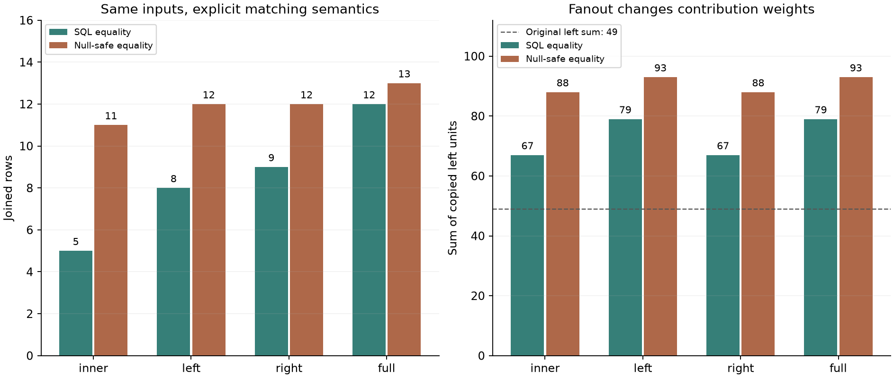

# Join fanout contracts

**Know what a join will multiply before materializing it.** This small
data-engineering project computes exact equijoin row counts, unmatched input
counts, duplicated-key diagnostics, and copied measure sums from per-key
frequency tables.

It makes null semantics and expected relationships explicit, supports
machine-readable failures in a pipeline, and checks its results against
independently materialized SQLite joins. The audit engine uses only the Python
standard library. All demonstration records are synthetic; no real customers,
transactions, identifiers, or private datasets are used.



## Reproduce

Python 3.11 or newer; SQLite 3.39 or newer is required by the tests and demo
because their reference checks use native right/full joins.

```bash
git clone https://github.com/lcx0731/join-fanout-contracts.git
cd join-fanout-contracts
python3 -m venv .venv
source .venv/bin/activate
python -m pip install ".[test]"
python -c "import sqlite3; print(sqlite3.sqlite_version)"
python -m pytest -W error
PYTHONWARNINGS=error join-audit-demo --output results
python -m pip check
```

The demo writes `results/summary.json`, `results/left.json`,
`results/right.json`, and `results/join-semantics.png`. It checks all eight
combinations of inner/left/right/full joins and SQL/null-safe matching.
It also audits a large hypothetical output **without** executing that join.

For the recorded environment, create a fresh CPython 3.13 environment and use:

```bash
python -m pip install -r requirements-repro.txt
python -m pip install --no-deps .
python -m pytest -W error
PYTHONWARNINGS=error join-audit-demo --output reproduced-results
cmp results/summary.json reproduced-results/summary.json
```

The committed run used CPython 3.13.0 and SQLite 3.45.3. The dependency snapshot
is not a cross-platform or hash lockfile and does not install SQLite itself.
The JSON is deterministic, including contributor ordering; PNG rendering can
vary by platform. CI tests Python 3.11 and 3.13 and runs the complete demo.
For the audit API/CLI alone, `pip install .` needs no third-party dependencies.
The `test` extra adds pytest and matplotlib for tests and figures.

## CLI: inspect first, enforce a contract explicitly

A permitted left join:

```bash
join-audit results/left.json results/right.json \
  --keys customer_id --how left \
  --left-measure units --right-measure weight \
  --max-output-rows 8
```

This prints JSON and exits 0: the exact output count is eight.
The default relationship is unrestricted `many-to-many`; it does not silently
assume a lookup-table relationship.

An intentionally failing contract:

```bash
join-audit results/left.json results/right.json \
  --keys customer_id --how left \
  --relationship many-to-one --max-output-rows 7 --require-left-match
```

This prints a complete JSON report with `"ok": false` and exits **2**, with
three reasons: one duplicated matchable right key, eight output rows exceeding
the budget of seven, and three left rows having no match.

Invalid input also exits 2, but produces an error on stderr rather than a
partial audit on stdout. The CLI rejects duplicate JSON object fields and
nonstandard `NaN`/`Infinity` constants; it never edits the input files.

**The tool does not execute a database join, lock a table, or intercept other
code.** A caller must respect the exit status or call `report.enforce()` before
its own join. The audit and execution must use the same data snapshot,
predicates, collation, and null rules. It cannot guarantee a later join against
concurrently changed data.

## Exact accounting

For a matchable key $k$, let $l_k,r_k$ be the input row counts. A matched key
emits $l_k r_k$ rows. Every left value is copied $r_k$ times, and every right
value is copied $l_k$ times.

Let $M$ be the sum of matched products, and let $U_L,U_R$ be the numbers of
unmatched **input** rows. Then:

| Join | Exact output rows |
| --- | --- |
| inner | $M$ |
| left | $M+U_L$ |
| right | $M+U_R$ |
| full | $M+U_L+U_R$ |

If a key does not match, a preserved-side input row appears once, with nulls on
the other side. A dropped-side input row contributes nothing. These same
copy factors multiply each group's non-null measure count and sum, so the
reported aggregates do not require constructing the Cartesian products.

`output_value_count` is analogous to `COUNT(side.measure)`, not `COUNT(*)`.
`output_sum` is null when there are no non-null contributed values, and zero
when actual contributed values sum to zero. Original input counts and sums
are reported separately. Negative measures are supported.

Integer arithmetic is exact: individual keys and measures must fit signed
64-bit integers, while computed counts and sums use Python's arbitrary-precision
integers. A database's bounded integer `SUM` could overflow even when this
mathematical sum does not.

## Nulls, keys, and relationship semantics

- `nulls="sql"`: any null component makes a composite key unmatchable, including
  against an identical null-containing key.
- `nulls="null_safe"`: corresponding null components match each other. The
  SQLite oracle implements this with `IS`, equivalent there to
  `IS NOT DISTINCT FROM`.
- Non-null components must have a single type, per key position, across both
  inputs: built-in `int` or valid UTF-8 `str`. Integers are signed int64.
  Booleans, floats, bytes, mixed string/integer components, and implicit
  coercions are rejected.
- Strings use exact equality: no case folding, locale collation, trimming,
  or Unicode normalization. Empty strings are values, not nulls. Missing
  required fields are errors, not implicit nulls.
- Each requested measure must be a signed int64 integer or null. Other
  record fields are ignored.

The relationship contract specifies which side must have unique **matchable**
keys, across that entire input even if a key is absent from the other side:

| Relationship | Required uniqueness |
| --- | --- |
| one-to-one | Both sides |
| one-to-many | Left side |
| many-to-one | Right side |
| many-to-many | Neither side |

Under SQL matching, repeated null-containing keys do not violate uniqueness,
because they cannot match. They still count as unmatched rows and can fail a
coverage requirement. Under null-safe matching, repeated null keys do count
as duplicates. This is this tool's explicit join contract, not a claim of
identical semantics to every database constraint or dataframe API.

`require_left_match` and `require_right_match` are separate coverage contracts.
Unmatched counts always describe the original inputs, even if that side is
discarded by the chosen join. `max_output_rows` is inclusive: equality passes.

## Synthetic results

The left input has six rows with total units 49. The right input has seven
rows with total weight 28. Both contain duplicate `A` keys and null keys;
`C` appears only on the left and `D` only on the right. Full records are saved
in the two small input JSON files.

| Null rule | Join | Output rows | Copied left-unit sum | Copied right-weight sum |
| --- | --- | ---: | ---: | ---: |
| SQL | inner | 5 | 67 | 9 |
| SQL | left | 8 | 79 | 9 |
| SQL | right | 9 | 67 | 31 |
| SQL | full | 12 | 79 | 31 |
| Null-safe | inner | 11 | 88 | 45 |
| Null-safe | left | 12 | 93 | 45 |
| Null-safe | right | 12 | 88 | 49 |
| Null-safe | full | 13 | 93 | 49 |

Each row of this table was checked against actual SQLite output. In the
SQL left join, the `A` key alone creates four rows and copies its left total
of 30 twice. The two left null rows remain unmatched and appear once each.
Under null-safe matching, two left null rows meet three right null rows,
creating six matches instead.

The original left sum of 49 in the plot is a comparison baseline, **not** an
invariance requirement for arbitrary joins. Repeated contributions can be
intentional in a many-to-many relationship; domain correctness is not inferred
from row counts alone. The tool does not choose a deduplication rule or silently
discard records.

### Large output, small frequency summary

The hot-key example scans a left generator of 20,000 rows and a right generator
of 15,000 rows, each with the same key:

- Input rows consumed: **35,000**.
- Frequency-group entries: **2** total, one in each input.
- Exact hypothetical inner-join output: **300,000,000** rows.
- Left copied-unit sum: **300,000,000**; right copied-unit sum: **600,000,000**.
- Row budget: **1,000,000**, so the contract fails.
- Materialized join rows in this example: **0**; SQLite is deliberately not
  invoked on this case.

These are exact cardinality/accounting results, not measured runtime or memory
benchmarks. The frequency audit avoids expanding the output, but its memory is
not constant when the number of distinct keys grows.

## API

```python
from join_fanout import audit_join

report = audit_join(
    [{"id": "A", "units": 10}, {"id": "A", "units": 20}],
    [{"id": "A"}, {"id": "A"}],
    keys=["id"],
    how="left",
    nulls="sql",
    left_measure="units",
    relationship="many-to-one",
    max_output_rows=100,
)
assert report.output_rows == 4
assert report.left_measure.output_sum == 60
print(report.violations)
# Raises JoinContractError because the right key is duplicated:
report.enforce()
```

The API accepts one-pass iterables of mappings. It stores frequency tables,
not original rows or joined rows. `to_dict()` produces a JSON-serializable
report. `top_contributors` contains at most `top_k` emitted key groups,
ordered by output count descending and then key order (null before non-null).
These diagnostics contain key values; treat reports as potentially sensitive
when using the tool on your own data.

## Tests and boundaries

The 77 pytest cases include actual SQLite checks for all join/null combinations,
12 seeded small-input cases exercised across all eight modes, empty inputs,
composite keys, nulls, negative/zero/all-null measures, sums beyond int64,
relationship direction, coverage, row-budget boundaries, one-pass generators,
100-million-row hypothetical output, deterministic ordering across hash seeds,
strict input rejection, CLI exit codes, unchanged input files, and full-demo
reproduction.

The independent SQLite oracle uses generated SQL column names and bound values.
It materializes only bounded small inputs and sums returned integers in Python
to avoid SQLite aggregate overflow. It does not reuse the frequency-table
counting logic.

Limitations:

- One equijoin with bag semantics only: no range/as-of joins, predicates beyond
  component equality, post-join filters, `DISTINCT`, collation transformations,
  or multi-join query optimization.
- With $N$ input rows and $U$ distinct key groups, scanning is expected $O(N)$
  hash-table work and contributor sorting is $O(U\log U)$, for fixed key width.
  Key hashing/comparison also depends on key size. Storage is $O(U)$ plus the
  returned report, not a guarantee of bounded memory for high-cardinality data.
- Unlike the iterable API, the JSON CLI loads both input arrays into memory.
- The row budget is checked **after** scanning; it limits hypothetical output,
  not scan cost, input size, or frequency-table memory.
- Audits describe the consumed snapshot. They do not guarantee future data
  consistency, meaningful business metrics, or safe execution of another query.
- Only null, string, and integer key components, and nullable integer measures,
  are supported. Choose explicit preprocessing for other types.

## References

- SQLite [SELECT and join semantics](https://sqlite.org/lang_select.html).
- SQLite [expression and null-comparison semantics](https://sqlite.org/lang_expr.html).

The implementation, synthetic fixtures, and tests were written for this
project; no reference implementation was copied.
Released under the [MIT License](LICENSE).
